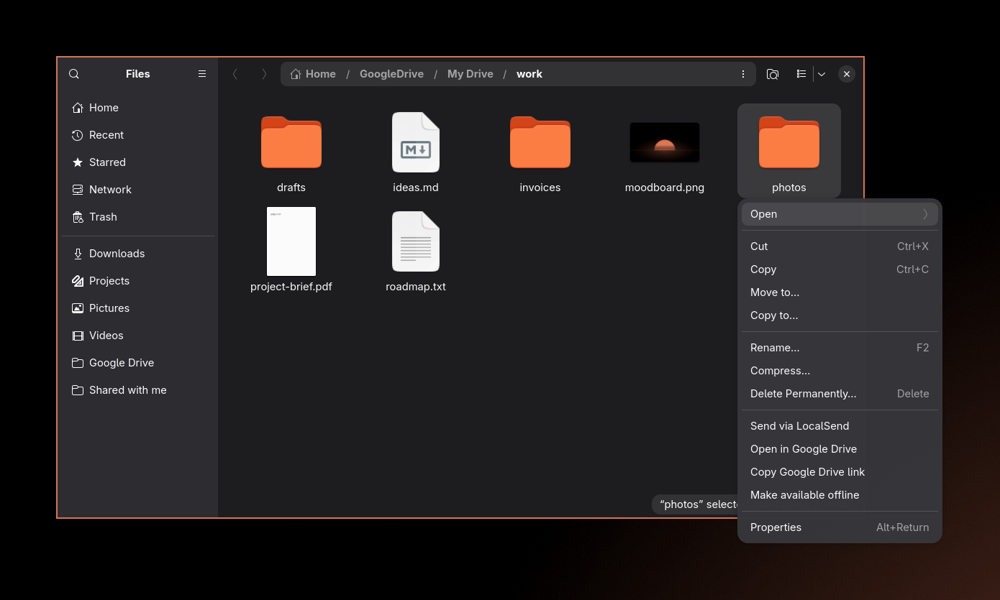
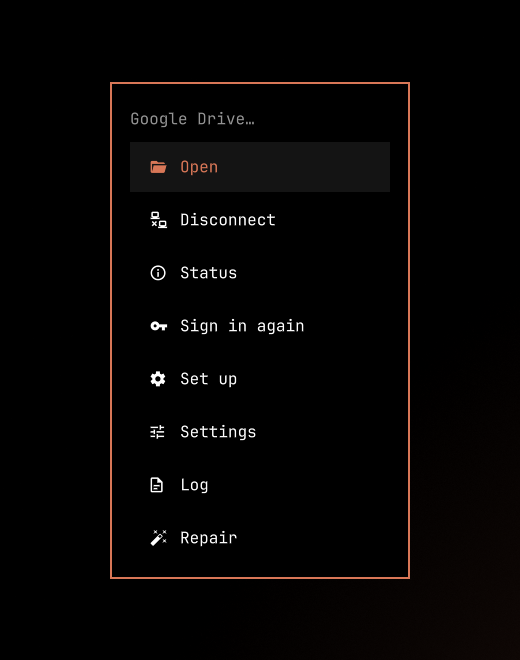
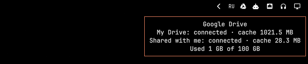

# omarchy-gdrive

google drive as a normal folder on [omarchy](https://omarchy.org/).
open, edit and save your drive files from files, the terminal or any app.
built on [rclone](https://rclone.org/).



- **files**: bookmarks for my drive, shared with me and your shared drives
- **right-click**: open in google drive, copy link, make available offline
- **bar**: a drive icon that shows connected, uploading, offline or error
- **menu**: omarchy menu → google drive
- **hotkey**: `super + ctrl + g` opens drive
- **auto-connect** at login, waits for the network, finishes uploads at shutdown

<p>
  
  
</p>

## install

you need omarchy 4 (the `quattro` branch: hyprland with a lua config and the quickshell bar).

**1. install the plugin**

```bash
git clone https://github.com/gloomyweather/omarchy-gdrive-app.git ~/.local/src/omarchy-gdrive
~/.local/src/omarchy-gdrive/install.sh
nautilus -q
```

the installer asks for your sudo password if it needs packages (rclone and a few small tools).

**2. create your google key** (about 10 minutes, once)

google needs to know which app is asking for your drive. follow **[the oauth guide](OAUTH.md)**.
at the end you have a *client id* and a *client secret*.

**3. connect**

```bash
omarchy-gdrive setup
```

or use the omarchy menu: **google drive → set up**. paste the client id and the secret,
sign in to google in the browser that opens, and pick the drives you want.

done. your drive is in the files sidebar and in `~/GoogleDrive`.

## use

| to | do |
|---|---|
| open drive | `super + ctrl + g`, the drive icon in the bar, or the sidebar in files |
| see what is going on | hover the bar icon, or run `omarchy-gdrive status` |
| disconnect / connect | omarchy menu → google drive, or `omarchy-gdrive disconnect` / `connect` |
| sign in again | omarchy menu → google drive → sign in again |
| change settings | omarchy menu → google drive → settings, then `omarchy-gdrive restart` |

good to know:

- google docs, sheets and slides appear as `name.link.html` and open in your browser.
- deleting a file moves it to the google drive trash. restore it at drive.google.com.
- saved files upload in the background a few seconds after you close them.
- without network, folders and already opened files still work. new changes upload later.
  need files that were never opened? right-click a folder → **make available offline**.
- after `omarchy refresh ...` the hotkey, menu or bar icon may be gone: run `omarchy-gdrive repair`.
- google drive sits below system in the omarchy menu. to keep system last, set
  `MENU_SYSTEM_LAST=true` in settings and run `omarchy-gdrive repair`.

run `omarchy-gdrive help` for all commands. problems? see [troubleshooting](TROUBLESHOOTING.md).

## uninstall

```bash
omarchy-gdrive uninstall                  # keeps your google sign-in and settings
omarchy-gdrive uninstall --purge-config   # also deletes the sign-in and settings
```

files in google drive are never touched.

## privacy

everything runs on your computer and talks only to google. your sign-in is stored
in an encrypted rclone config, its password is in your keyring. nothing is sent
anywhere else. see the [privacy policy](https://gloomyweather.github.io/omarchy-gdrive-app/privacy.html).

## license

[mit](LICENSE)
